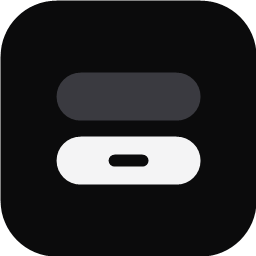
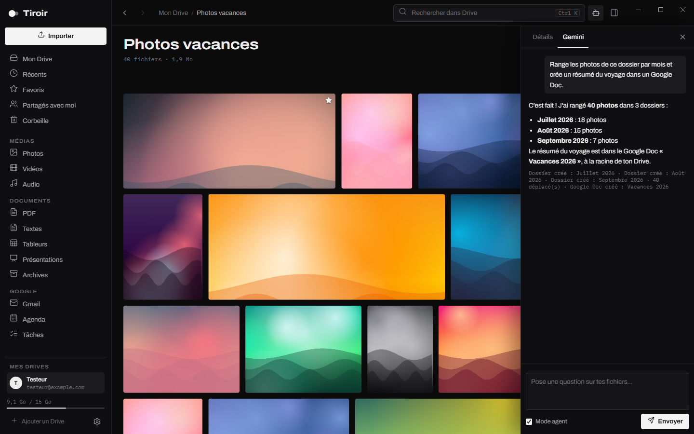
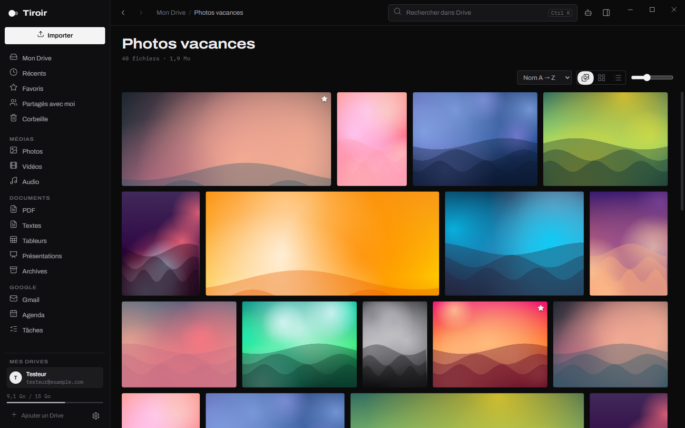
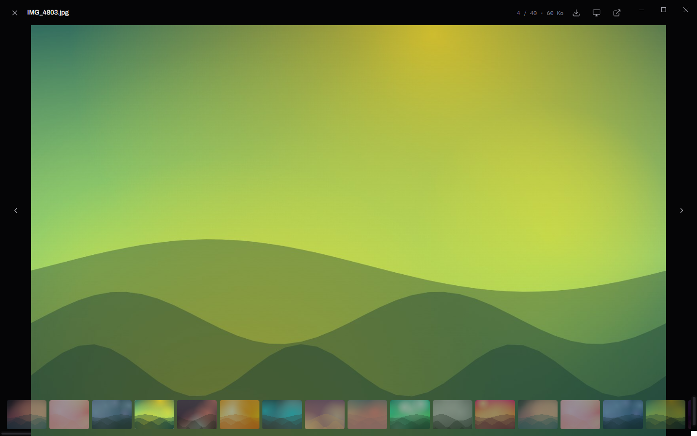
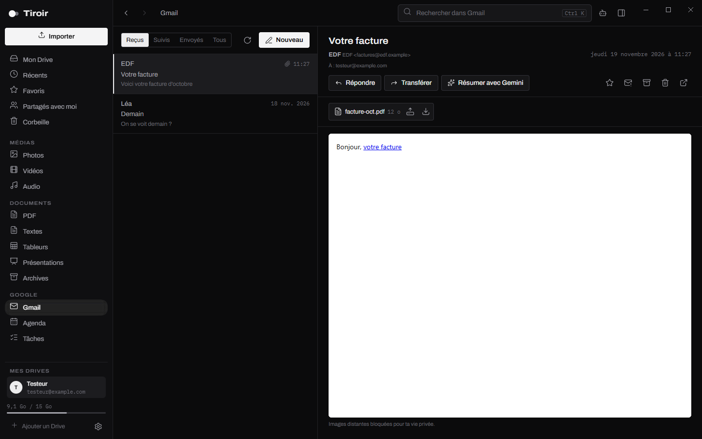
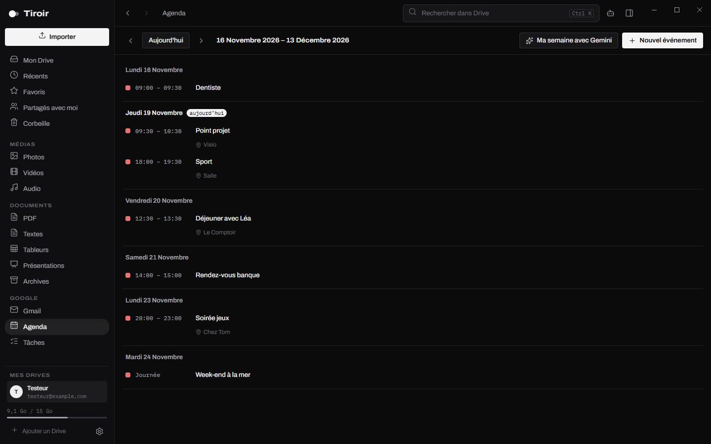
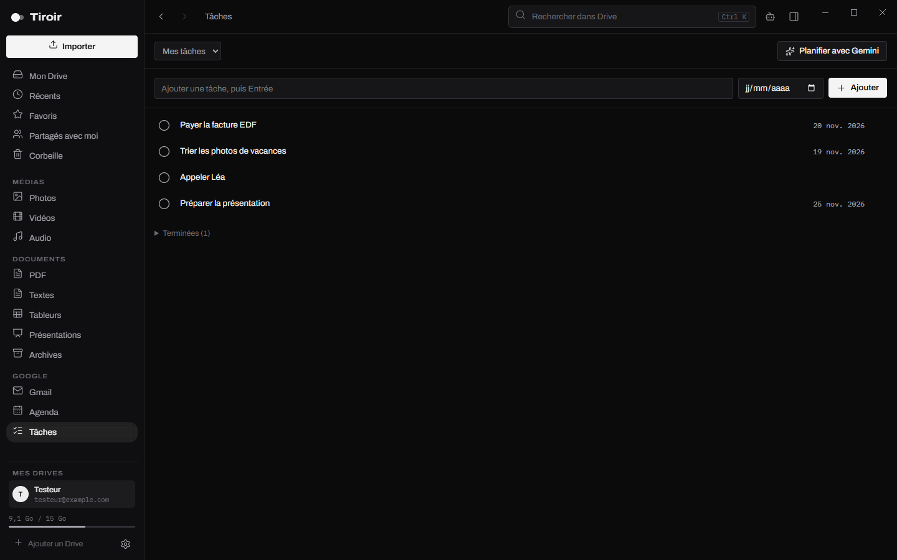
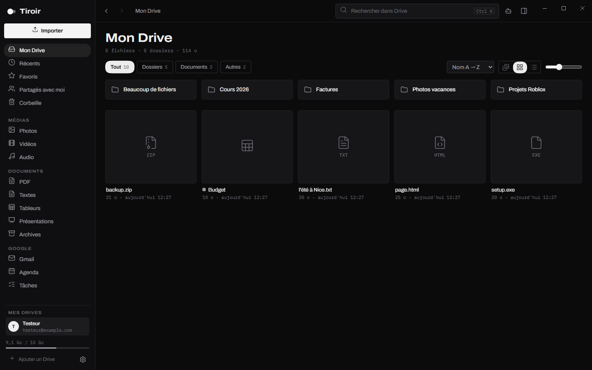
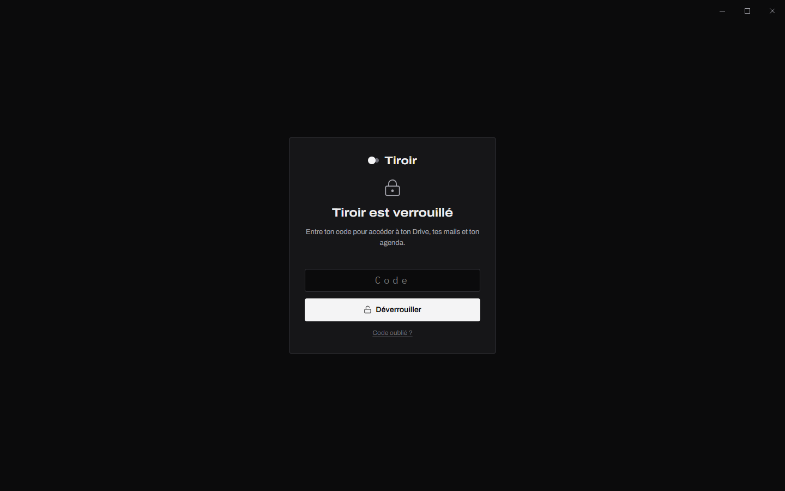
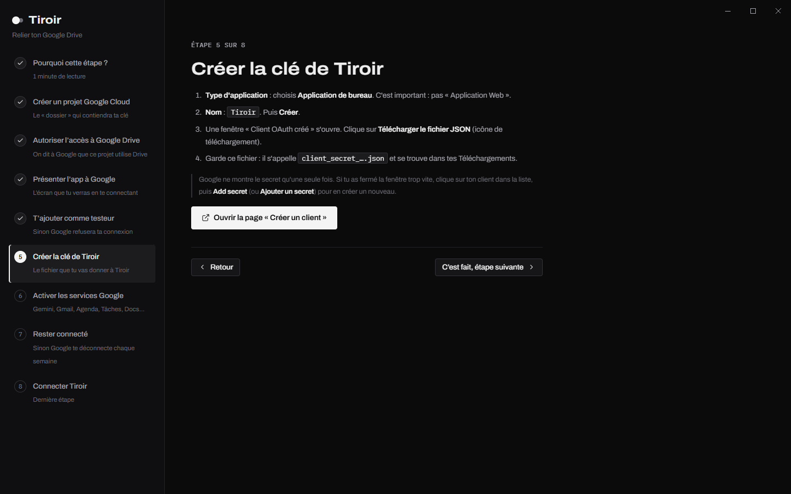

<p align="center">
  
</p>

<h1 align="center">Tiroir</h1>

<p align="center">
  <b>Ton Google Drive, Gmail, Agenda et Tâches dans une seule app de bureau, avec Gemini intégré.</b><br>
  Rapide, sombre, sans serveur intermédiaire : tes données vont directement de ton PC à Google.
</p>

<p align="center">
  <a href="../../releases/latest"></a>
  
  <a href="LICENSE"></a>
</p>

<p align="center">
  
</p>

---

## Sommaire

- [Fonctionnalités](#fonctionnalités)
- [Télécharger et installer](#télécharger-et-installer)
- [Premier lancement](#premier-lancement)
- [Sécurité et vie privée](#sécurité-et-vie-privée)
- [Raccourcis clavier](#raccourcis-clavier)
- [Questions fréquentes](#questions-fréquentes)
- [Développement](#développement)
- [Licence](#licence)

## Fonctionnalités

### 📁 Google Drive, en vrai logiciel de bureau
- Grille, liste ou **galerie** avec les vraies proportions des photos, vignettes nettes, aperçu des vidéos au survol.
- Visionneuse plein écran pour photos, vidéos, PDF et documents Google.
- **Glisser-déposer** : importe des dossiers entiers, déplace des fichiers, ou glisse-les vers l'Explorateur, Discord, etc.
- Copier, couper, coller, renommer, favoris, corbeille, Drives partagés, plusieurs comptes Google.
- Menus **instantanés** : les listes sont préchargées, un dossier se charge dès que la souris passe dessus.
- Filtre **« Mes fichiers »** pour masquer ce que d'autres t'ont partagé, et le dossier exact de chaque fichier dans le panneau Détails.

<table>
  <tr>
    <td width="50%"></td>
    <td width="50%"></td>
  </tr>
  <tr>
    <td align="center"><sub>La galerie respecte le format de chaque photo</sub></td>
    <td align="center"><sub>Visionneuse avec bande de miniatures</sub></td>
  </tr>
</table>

### ✨ Gemini, avec ton compte Google
Pas de clé API à copier : Gemini passe par la même connexion que ton Drive.
- **Mode lecture** : pose une question sur tes fichiers, tes mails ou ton agenda (« c'est dans quel dossier ? », « résume ce PDF »).
- **Mode agent** : Gemini range ton Drive, crée de vrais **Google Docs, Sheets et Slides**, prépare tes mails, ajoute des événements et des tâches.
- Il **demande toujours ta confirmation** avant d'envoyer un mail ou de supprimer quoi que ce soit.
- Le modèle le plus récent est choisi automatiquement : quand Google retire un modèle, Tiroir passe au suivant tout seul.

### ✉️ Gmail, Agenda et Tâches
<table>
  <tr>
    <td width="50%"></td>
    <td width="50%"></td>
  </tr>
  <tr>
    <td align="center"><sub><b>Gmail</b> : lecture, réponse, pièces jointes vers le Drive en un clic</sub></td>
    <td align="center"><sub><b>Agenda</b> : les 4 prochaines semaines, création d'événements</sub></td>
  </tr>
  <tr>
    <td width="50%"></td>
    <td width="50%"></td>
  </tr>
  <tr>
    <td align="center"><sub><b>Tâches</b> : échéances, tâches terminées repliées</sub></td>
    <td align="center"><sub><b>Mon Drive</b> : dossiers d'abord, filtres par type</sub></td>
  </tr>
</table>

- Les mails HTML s'affichent dans un cadre isolé : aucun script, et les **images de pistage sont bloquées**.

### 🔒 Verrou par code
Active un code dans les Réglages : il est demandé à chaque ouverture et après une absence (5 min à 1 h), ou tout de suite avec <kbd>Ctrl</kbd>+<kbd>L</kbd>. Ce n'est pas qu'un écran : tes connexions Google sont **chiffrées avec ce code**.

<p align="center"></p>

## Télécharger et installer

Va dans les **[Releases](../../releases/latest)** et choisis :

| Fichier | Pour qui |
|---|---|
| `Tiroir-Setup-x.y.z.exe` | **Recommandé.** Installe Tiroir avec un raccourci sur le Bureau et dans le menu Démarrer. |
| `Tiroir-Portable-x.y.z.exe` | Un seul fichier à lancer sans installation (un peu plus lent au démarrage). |

> [!NOTE]
> Tiroir n'est pas signé avec un certificat payant. Au premier lancement, Windows affiche « Windows a protégé votre ordinateur » : clique sur **Informations complémentaires**, puis **Exécuter quand même**. L'empreinte SHA-256 de chaque fichier est indiquée dans la release.

## Premier lancement

Google exige que chaque application qui accède à un Drive ait sa propre clé. Comme Tiroir n'a **aucun serveur**, tu crées ta clé personnelle : c'est gratuit, sans carte bancaire, et à faire une seule fois (environ 10 minutes). Un **guide pas à pas** est intégré à l'app et ouvre chaque page Google pour toi :

<p align="center"></p>

1. Créer un projet Google Cloud nommé « Tiroir ».
2. Activer l'API Google Drive.
3. Configurer l'écran de connexion et t'ajouter comme testeur.
4. Créer un client OAuth de type **Application de bureau** et télécharger son fichier JSON.
5. Activer les autres services (Gemini, Gmail, Agenda, Tasks, Docs, Sheets, Slides) en un seul clic.
6. Passer l'app « en production » pour ne pas être déconnecté chaque semaine.
7. Glisser le fichier JSON dans Tiroir et te connecter avec Google.

## Sécurité et vie privée

- **Aucun intermédiaire** : Tiroir parle directement aux API de Google. Ni l'auteur ni personne d'autre ne voit tes données.
- **Serveur local fermé** : l'interface tourne sur `127.0.0.1` uniquement, refuse les autres sites (protection contre le *DNS rebinding*) et exige un cookie de session secret.
- **Connexions chiffrées** : les jetons Google sont scellés par Windows (DPAPI), et en plus par ton code si le verrou est activé (scrypt + AES-256-GCM).
- **Rien ne traîne** : aperçus, caches et copies temporaires sont effacés à la fermeture. Il ne reste que tes réglages.
- **Fichiers ouverts avec prudence** : les téléchargements sont marqués « venant d'Internet » (SmartScreen, Mode protégé d'Office), et un `.exe`, `.bat` ou `.lnk` venant du Drive n'est jamais lancé directement.
- **Gemini sous contrôle** : le contenu des fichiers et des mails est traité comme une donnée, jamais comme un ordre, et toute action sensible demande ta confirmation.
- **Fenêtre verrouillée** : pas de caméra, micro ni localisation, et les liens externes s'ouvrent dans ton vrai navigateur.

> [!IMPORTANT]
> Sans facturation activée sur ton projet Google, Gemini utilise les conditions gratuites de Google : ce que tu lui envoies peut servir à améliorer ses modèles. Évite d'y joindre des documents sensibles, ou active la facturation (quelques centimes pour un usage personnel).

Tu peux retirer l'accès de Tiroir à tout moment sur [myaccount.google.com/permissions](https://myaccount.google.com/permissions).

## Raccourcis clavier

| Raccourci | Action |
|---|---|
| <kbd>Ctrl</kbd>+<kbd>K</kbd> | Rechercher (dans Drive ou dans Gmail) |
| <kbd>Ctrl</kbd>+<kbd>G</kbd> | Demander à Gemini (joint les fichiers sélectionnés) |
| <kbd>Ctrl</kbd>+<kbd>I</kbd> | Panneau Détails |
| <kbd>Ctrl</kbd>+<kbd>L</kbd> | Verrouiller Tiroir |
| <kbd>Espace</kbd> | Aperçu |
| <kbd>F2</kbd> | Renommer |
| <kbd>Suppr</kbd> | Mettre à la corbeille |
| <kbd>Ctrl</kbd>+<kbd>C</kbd> / <kbd>X</kbd> / <kbd>V</kbd> | Copier, couper, coller |
| <kbd>Ctrl</kbd>+<kbd>U</kbd> | Importer des fichiers |
| <kbd>Ctrl</kbd>+<kbd>Maj</kbd>+<kbd>N</kbd> | Nouveau dossier |
| <kbd>Alt</kbd>+<kbd>←</kbd> / <kbd>→</kbd> | Précédent, suivant |
| <kbd>F5</kbd> | Actualiser |

## Questions fréquentes

<details>
<summary><b>Google affiche « Google n'a pas validé cette application »</b></summary>

C'est normal : c'est **ta propre** app, créée dans ton projet Google. Clique sur **Continuer**. Par contre, ne le fais jamais pour une app que tu ne connais pas.
</details>

<details>
<summary><b>Je dois me reconnecter chaque semaine</b></summary>

Ton projet Google est encore « en test ». Dans Google Cloud, page **Audience**, clique sur **Publier l'application**. Aucune vérification n'est demandée pour un usage personnel.
</details>

<details>
<summary><b>Une vidéo ne se lit pas</b></summary>

Certains formats (HEVC de téléphone, `.mkv`, `.avi`) ne sont pas lus par le lecteur intégré. Tiroir propose alors de la lire dans Google Drive ou de l'ouvrir avec ton application habituelle.
</details>

<details>
<summary><b>J'ai oublié mon code de verrouillage</b></summary>

Sur l'écran de verrouillage, clique sur **Code oublié ?**. Tiroir oublie tes connexions chiffrées et tu reconnectes ton compte Google. Tes fichiers restent intacts dans Google Drive.
</details>

<details>
<summary><b>Où sont mes réglages ?</b></summary>

Dans `%APPDATA%\Tiroir\config.json`. Un journal de diagnostic (sans aucun jeton) se trouve dans `%APPDATA%\Tiroir\tiroir.log` et ne dépasse jamais 1 Mo.
</details>

## Développement

Prérequis : [Node.js](https://nodejs.org) 22 ou plus récent.

```bash
npm install          # dépendances (Electron, electron-builder, icônes, polices)
npm start            # lance Tiroir en mode développement
npm test             # tests de bout en bout contre un faux Google
npm run dist         # crée l'installateur et la version portable dans dist/
```

> [!TIP]
> Avec npm 11 ou plus récent, les scripts d'installation sont bloqués par défaut : lance `node node_modules/electron/install.js` si Electron ne démarre pas. Si l'installateur échoue sous Windows à cause d'un chemin trop long, compile depuis un dossier court (par exemple `C:\tiroir`).

**Tester sans compte Google** : `node test/mock-drive.js` démarre un faux Drive (fichiers, Gmail, Agenda, Tâches, Gemini), puis ouvre http://localhost:4171/?k=demo0000demo. Pour avoir de vraies images dans la galerie, indique un dossier de `.jpg` avec la variable `TIROIR_MOCK_WALLS`.

### Organisation du code

| Fichier | Rôle |
|---|---|
| `app/main.js` | Fenêtre Electron sans cadre, permissions, nettoyage à la fermeture |
| `server.js` | Serveur local : Drive, OAuth, Gemini, verrou, sécurité |
| `services.js` | Gmail, Agenda, Tasks, Docs, Sheets, Slides et les outils de l'agent Gemini |
| `web/` | Interface (HTML, CSS et JavaScript sans framework, grille virtualisée) |
| `test/` | Faux Google en mémoire et tests de bout en bout |

## Licence

Tiroir est distribué sous licence **[GNU GPL v3.0](LICENSE)** : tu peux l'utiliser, l'étudier, le modifier et le redistribuer, à condition que les versions modifiées restent libres sous la même licence.

<p align="center"><sub>Tiroir n'est ni affilié à Google ni approuvé par Google. Google Drive, Gmail, Google Agenda, Google Tasks et Gemini sont des marques de Google LLC.</sub></p>
